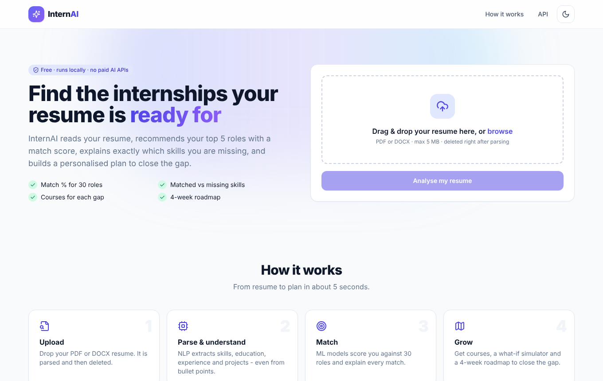
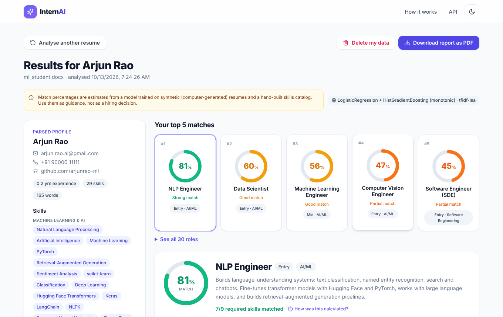
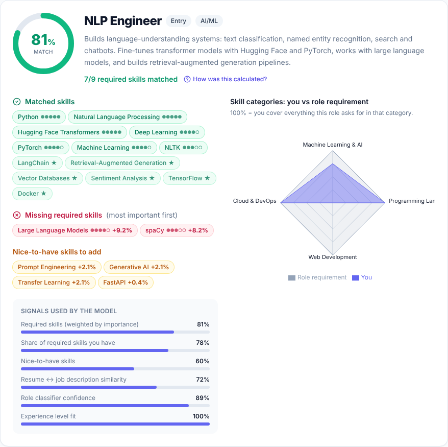
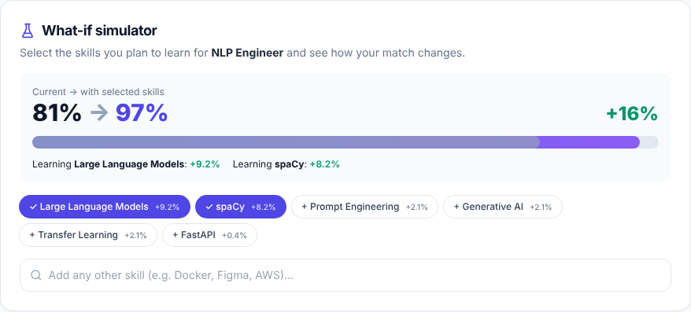
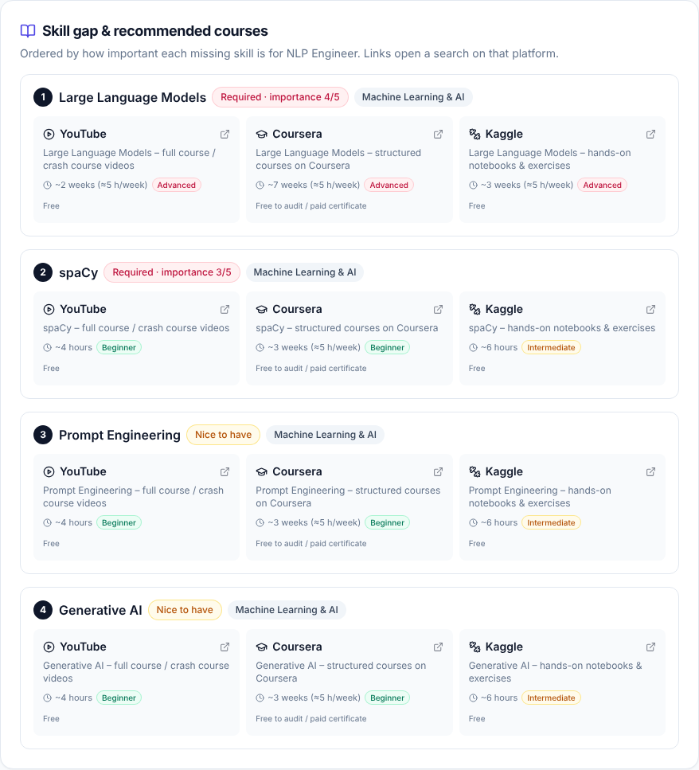
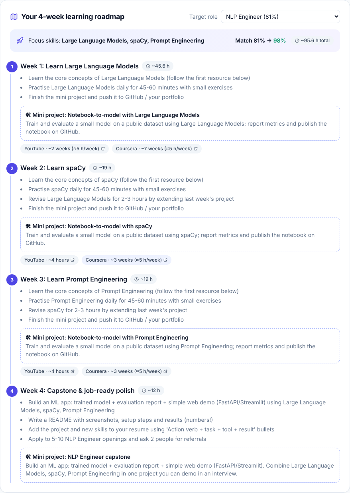
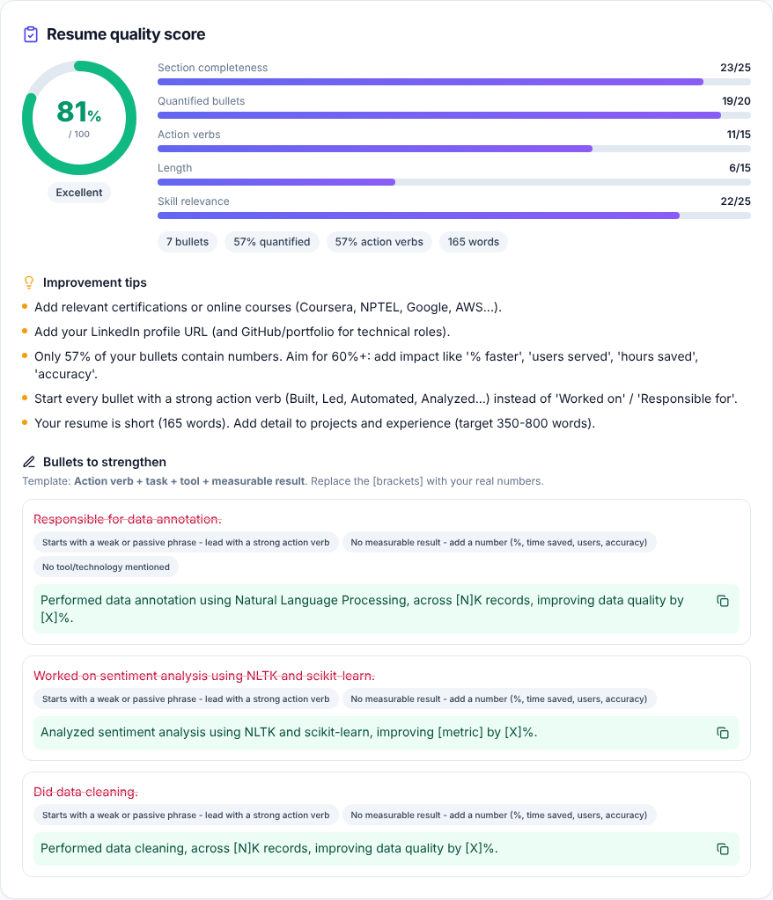
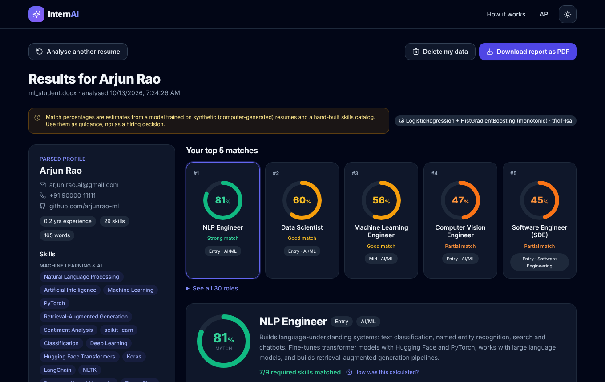
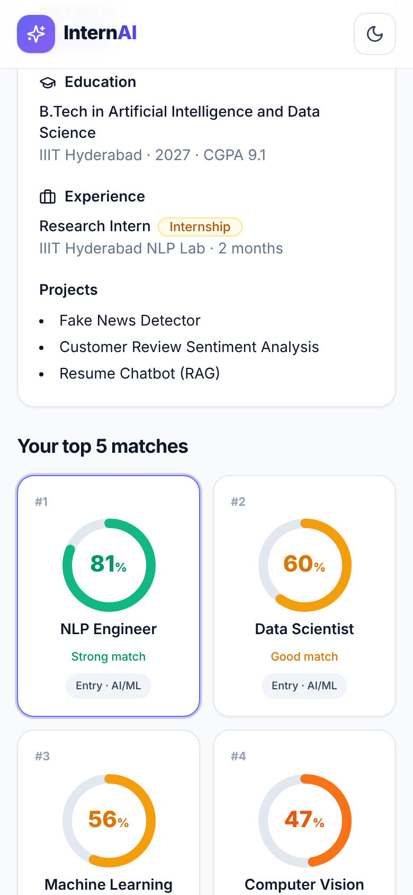
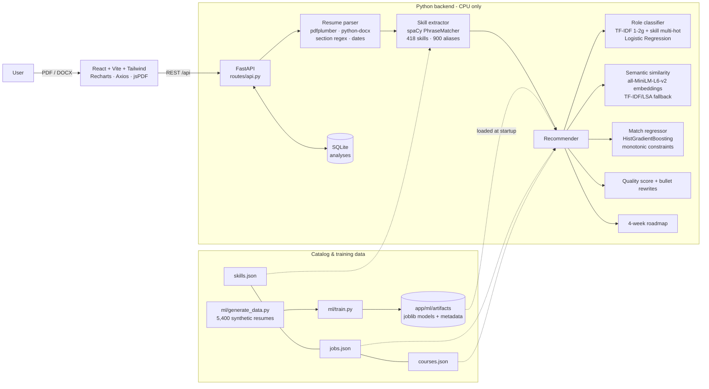

# InternAI

Upload a resume (PDF or DOCX) to InternAI. It:

1. recommends your **top 5 jobs or internship roles** out of 30,
2. shows a **match percentage** for each,
3. **explains** each match: matched skills vs missing skills, with importance weights, a skills radar and the model's signals,
4. recommends **courses** for every missing skill,
5. includes a **what-if simulator**: pick the skills you plan to learn and your match % recalculates instantly,
6. gives a **resume quality score** (0–100) with tips and rewritten bullet points,
7. builds a **4-week learning roadmap** for any target role,
8. exports the whole report **as a PDF**.

Everything runs locally on CPU with free, open-source models. No paid APIs.

> ⚠️ **Disclaimer.** The models are trained on **synthetic** (computer-generated) resumes and a hand-built skills catalog. Match percentages are estimates to guide you, not hiring decisions. See [Limitations](#limitations).

---

## Contents
- [Quick start (Windows)](#quick-start-windows)
- [Quick start (macOS / Linux)](#quick-start-macos--linux)
- [Manual setup, step by step](#manual-setup-step-by-step)
- [Screenshots](#screenshots)
- [Architecture](#architecture)
- [Project structure](#project-structure)
- [How the match % is calculated](#how-the-match--is-calculated)
- [Model evaluation](#model-evaluation)
- [API documentation](#api-documentation)
- [Testing](#testing)
- [Docker & deployment](#docker--deployment)
- [Configuration](#configuration)
- [Limitations](#limitations)
- [Troubleshooting](#troubleshooting)

---

## Quick start (Windows)

Requirements: **Python 3.11** (tick "Add to PATH" when installing) and **Node.js 18+**.

```bat
cd "D:\intern ai\internai"
setup.bat      :: one time: installs packages, generates data, trains the models (~5-10 min)
start.bat      :: opens the API (port 8000) and the website (port 5173)
```

Then open **http://localhost:5173**. The API docs are at **http://localhost:8000/docs**.

## Quick start (macOS / Linux)

```bash
cd internai
./setup.sh
./start.sh     # website: http://localhost:5173
```

## Manual setup, step by step

```bash
# ---------- backend ----------
cd backend
python -m venv .venv
.venv\Scripts\activate            # Windows      (macOS/Linux: source .venv/bin/activate)
pip install -r requirements.txt
python -m spacy download en_core_web_sm

python -m app.ml.build_courses     # Step 1: build courses.json from skills.json
python -m app.ml.validate_catalog  # Step 1: check the catalog (prints "Catalog OK")
python -m app.ml.generate_data     # Step 2: 5,400 synthetic resumes + 20k match pairs
python -m app.ml.train             # Step 4: train + evaluate, saves app/ml/artifacts/
python -m pytest                   # Step 8: 70 tests

uvicorn app.main:app --reload --port 8000     # API on http://localhost:8000

# ---------- frontend (second terminal) ----------
cd frontend
npm install
npm run dev                                    # website on http://localhost:5173
```

**Production-style single server:** run `npm run build` in `frontend/` first. FastAPI then serves the built site, so `uvicorn app.main:app --port 8000` gives you the website at http://localhost:8000.

**Sample resumes** for testing are in `backend/samples/`: a fresher data analyst (PDF), an experienced backend developer (DOCX), a non-tech HR candidate (PDF), an ML student (DOCX) and a digital marketer (PDF). To regenerate them, run `python -m samples.make_samples`.

---

## Screenshots

| Landing & upload | Results dashboard |
|---|---|
|  |  |

| Role detail: matched vs missing skills, radar, model signals | What-if simulator |
|---|---|
|  |  |

| Skill gap & courses | 4-week roadmap |
|---|---|
|  |  |

| Resume quality score | Dark mode | Mobile |
|---|---|---|
|  |  |  |

---

## Architecture



**Request flow for an upload.** The upload is validated (extension, magic bytes, 5 MB limit) and saved to a temp file. It is then parsed, and the file is **deleted immediately**. Next, skills are extracted and expanded with implications (e.g. PostgreSQL → SQL), and all 30 roles are scored in one batch. Explanations, what-if gains, the quality score and courses are computed, and everything is stored in SQLite under an `analysis_id`.

---

## Project structure

```
internai/
├── setup.bat / start.bat / setup.sh / start.sh   one-command setup & run
├── Dockerfile               single container (website + API)
├── docker-compose.yml       two containers (nginx frontend + API)
├── render.yaml              Render blueprint
├── docs/screenshots/
├── backend/
│   ├── requirements.txt  pytest.ini  Dockerfile
│   ├── app/
│   │   ├── main.py              FastAPI app, CORS, error handler, serves frontend build
│   │   ├── config.py            paths, limits, env vars
│   │   ├── database.py          SQLAlchemy engine/session
│   │   ├── models/              db_models.py (Analysis table) · schemas.py (Pydantic)
│   │   ├── routes/api.py        all endpoints
│   │   ├── services/
│   │   │   ├── catalog.py         loads skills/jobs/courses, alias normalisation
│   │   │   ├── skill_extractor.py spaCy PhraseMatcher (loose + strict matchers)
│   │   │   ├── parser.py          text extraction, sections, contact, education, experience, projects
│   │   │   ├── features.py        shared feature engineering (train == inference)
│   │   │   ├── role_classifier.py TF-IDF + skills featurizer (sklearn transformer)
│   │   │   ├── embeddings.py      sentence-transformers / TF-IDF-LSA embedders
│   │   │   ├── model_store.py     loads artifacts, batched predictions, fallbacks
│   │   │   ├── recommender.py     ranking, explanations, what-if, courses
│   │   │   ├── quality.py         resume quality score + bullet rewrites
│   │   │   └── roadmap.py         4-week roadmap generator
│   │   ├── data/                skills.json · jobs.json · courses.json (+ generated CSVs)
│   │   └── ml/                  build_courses · validate_catalog · generate_data · train · artifacts/
│   ├── samples/                 5 real-style resumes (PDF/DOCX) + generator
│   └── tests/                   70 pytest tests
└── frontend/
    ├── package.json  vite.config.js  tailwind.config.js  Dockerfile  nginx.conf  vercel.json
    └── src/
        ├── api.js  pdf.js  App.jsx  main.jsx  index.css  hooks/useTheme.js
        ├── pages/   Landing.jsx · Results.jsx · NotFound.jsx
        └── components/  Dropzone · ProfileCard · RoleCard · CircularGauge · RoleDetail (radar)
                         WhatIf · CoursesList · QualityPanel · Roadmap · InfoTooltip
                         Skeleton · Disclaimer · ErrorBox · Navbar · Footer
```

---

## How the match % is calculated

For every (resume, role) pair the model computes 6 signals:

| Signal | Meaning |
|---|---|
| `weighted_overlap` | Σ weights of matched required skills ÷ Σ all required weights (weights 1–5 per role in `jobs.json`) |
| `pct_required` | Share of required skills you have |
| `nice_ratio` | Share of the role's nice-to-have skills you have |
| `semantic_similarity` | Cosine similarity between your resume profile (summary + titles + projects + skills) and the role description, using `all-MiniLM-L6-v2` |
| `classifier_prob` | Probability from the role classifier that your resume belongs to this role |
| `experience_fit` | 1.0 if your years of experience meet the role's minimum; −0.35 per missing year |

A **HistGradientBoostingRegressor with monotonic constraints** combines the signals into a 0–100 match %. "Monotonic" means that adding a skill or increasing similarity can never *lower* the score, which keeps the what-if simulator sensible. The result is clipped to 0–100 and rounded.

- **Missing skills** are sorted by `priority = weight × (1 + market demand)`, where demand is the share of roles that require the skill. Each one also shows its **what-if gain** ("+9%").
- **Implied skills.** Listing PostgreSQL implies SQL, and Spring Boot implies Java. Implied skills are shown greyed out in the profile.
- **Fallback.** If you have not trained the models yet, the API still works. It uses a transparent weighted formula (`features.heuristic_match`) with TF-IDF similarity instead.

---

## Model evaluation

Reference run (`python -m app.ml.train`, CPU, about 2 minutes, TF-IDF/LSA embeddings in the build sandbox). **Your run** writes its own numbers to `backend/app/ml/artifacts/metadata.json` and `confusion_matrix.png`. With sentence-transformers the numbers are similar.

**Data.** 5,400 synthetic resumes (180 per role × 30 roles, balanced) and 20,816 (resume, role, match_score) pairs. About 10% are hard cases: 5% hybrid profiles and 5% weak resumes.

**Generalisation split.** The models train on resume **styles 0–3** (3,558 resumes) and are validated on the **unseen styles 4–5** (1,842 resumes). The unseen styles have different headings, bullets, date formats and paragraph layouts, and style 4 has no skills section at all.

### a) Role classifier (validation = unseen styles)

| Model | Accuracy | Macro-F1 |
|---|---|---|
| **Logistic Regression** (chosen) | 0.987 | 0.987 |
| LinearSVC (calibrated) | 0.990 | 0.990 |
| Random Forest | 0.992 | 0.992 |

Logistic Regression is kept unless another model is better by more than 1 macro-F1 point, because it gives smoother, better-calibrated probabilities (they feed the regressor) and is small.

- Accuracy by case type: normal 0.998 · **hybrid 0.915** · **weak 0.848**.
- Most confused pairs: IoT Engineer ↔ Embedded Systems Engineer, and Full Stack ↔ Frontend Developer. These are realistic overlaps.

### b) Semantic similarity

Picking the role with the highest embedding similarity alone gets the true role right **98.6%** of the time.

### c) Match-score regressor (validation = unseen styles)

| Model | MAE | RMSE | R² |
|---|---|---|---|
| **HistGradientBoosting (monotonic)** (chosen) | **4.12** | 5.63 | 0.967 |
| Ridge | 4.27 | 5.77 | 0.966 |

### Ranking quality (true role's position in the recommendations, unseen styles)

| Top-1 | Top-3 | Top-5 |
|---|---|---|
| 99.2% | 99.95% | 100% |

### Parser accuracy on synthetic resumes (400-resume sample)

Skill recall is **99.5%**. Precision is 90%: the "false positives" are mostly real mentions the generator didn't count, such as tools in certifications. The mean error in years of experience is 0.08 years.

### Real-style resumes (Step 8, `backend/samples/`)

| Resume | Skills found | Years exp. | Top 3 recommendations | Quality |
|---|---|---|---|---|
| Fresher – data analyst (PDF) | 18 | 0.2 | Data Analyst 88%, Data Scientist 59%, Product Analyst 56% | 89 |
| Experienced – backend (DOCX) | 26 | 7.2 | Java Developer 100%, Backend Developer 57%, DevOps 49% | 87 |
| Non-tech – HR (PDF) | 11 | 0.4 | HR / Talent Acquisition 87%, Business Analyst 25%, Financial Analyst 24% | 82 |
| ML student (DOCX) | 29 | 0.2 | NLP Engineer 81%, Data Scientist 60%, ML Engineer 56% | 81 |
| Digital marketer (PDF) | 21 | 1.7 | SEO / Digital Marketing 91%, Technical Content Writer 50%, Data Analyst 29% | 86 |

> **Why are the synthetic scores so high?** Synthetic resumes come from templates and are much cleaner than real ones. Read these numbers as "the pipeline works and generalises to new layouts", **not** as real-world accuracy. Real resumes will score lower. See Limitations.

---

## API documentation

Interactive Swagger docs: **http://localhost:8000/docs** (ReDoc at `/redoc`).

| Method | Endpoint | Body / params | Returns |
|---|---|---|---|
| `POST` | `/api/upload` | multipart `file` (PDF/DOCX ≤ 5 MB) | `analysis_id`, parsed profile, top-5 summary |
| `GET` | `/api/analysis/{id}` | – | profile, `top_roles` (match, matched/missing skills, radar, courses, breakdown), `all_roles`, `quality`, `how_calculated`, `disclaimer` |
| `POST` | `/api/whatif` | `{"analysis_id", "role", "extra_skills": []}` | `base_match`, `new_match`, `delta`, `per_skill` gains |
| `GET` | `/api/roadmap/{id}?role=data_scientist` | role id or title | 4 weeks of goals, mini projects, resources, projected match |
| `GET` | `/api/roles` | – | all roles with weighted skills |
| `GET` | `/api/skills?q=dock` | search text | matching skills (for the what-if picker) |
| `DELETE` | `/api/analysis/{id}` | – | deletes stored data (204) |
| `GET` | `/api/health` | – | status, whether trained models are loaded, embedding backend |

**Errors**: 415 wrong file type / fake file, 413 > 5 MB, 422 unreadable or scanned PDF, 404 unknown analysis / role. Every error returns a friendly `{"detail": "..."}` message that the UI shows as is.

Example:

```bash
curl -F "file=@backend/samples/fresher_data_analyst.pdf" http://localhost:8000/api/upload
curl -X POST http://localhost:8000/api/whatif -H "Content-Type: application/json" \
     -d '{"analysis_id":"<id>","role":"Data Scientist","extra_skills":["Machine Learning","sklearn"]}'
```

---

## Testing

```bash
cd backend
python -m pytest          # 70 tests
```

| File | Covers |
|---|---|
| `test_catalog.py` | 300+ skills, 25+ roles, alias collisions, alias normalisation, case-sensitive words |
| `test_parser.py` | 3 sample resumes (PDF + DOCX): contact info, skills (incl. from bullets), sections, education, experience durations, headings, date formats, false-positive protection, bad files |
| `test_recommender.py` | top-5 ranking, priority ordering, courses, what-if, roadmap (incl. "nothing missing"), quality score, bullet rewrite template |
| `test_api.py` | every endpoint, file deletion after parsing, 404/413/415 errors, delete |
| `test_e2e_samples.py` | all 5 real-style resumes end to end: upload → analysis → what-if → roadmap |

The frontend was tested end to end in headless Chromium. That run covered: upload, the results dashboard, role switching, the what-if simulator, the tooltip, the roadmap, the quality panel, dark mode, PDF export, mobile layout and the error state.

---

## Docker & deployment

### One container (website + API on one port)

```bash
docker build -t internai .
docker run -p 8000:8000 internai          # http://localhost:8000
```

The image builds the React app, installs CPU-only PyTorch, generates the data and trains the models at build time. On low-RAM hosts, use `--build-arg EMBEDDINGS=tfidf`.

### docker-compose (nginx frontend + API)

```bash
docker compose up --build                 # website http://localhost:8080 · API http://localhost:8000/docs
```

### Render (backend, or everything)

1. Push the `internai` folder to GitHub.
2. In Render, choose **New → Blueprint** and select the repo. `render.yaml` deploys the root `Dockerfile` (website + API) with `INTERNAI_EMBEDDINGS=tfidf`, so it fits in 512 MB.
3. If you want only the API, create a **Web Service** with Docker, set the Dockerfile path to `backend/Dockerfile`, and set `INTERNAI_CORS_ORIGINS=https://<your-vercel-app>.vercel.app`.

### Railway (backend)

**New Project → Deploy from GitHub**. Railway detects the root `Dockerfile` and injects `$PORT`, which the container already uses. Add the variable `INTERNAI_EMBEDDINGS=tfidf` for the smallest plan.

### Vercel (frontend)

1. **New Project** → import the repo → **Root directory: `frontend`** (framework: Vite).
2. Set the environment variable `VITE_API_URL=https://<your-backend>.onrender.com`.
3. Deploy. `vercel.json` already rewrites all routes to `index.html` for client-side routing.
4. Put your Vercel URL in the backend's `INTERNAI_CORS_ORIGINS`.

> SQLite on free hosts is wiped on redeploy. That's fine for this app, because analyses are temporary. For persistence, set `INTERNAI_DB_URL` to a Postgres URL (and `pip install psycopg[binary]`).

---

## Configuration

| Env var | Default | Purpose |
|---|---|---|
| `INTERNAI_EMBEDDINGS` | `auto` | `auto` / `sentence-transformers` / `tfidf` |
| `INTERNAI_EMBEDDING_MODEL` | `sentence-transformers/all-MiniLM-L6-v2` | any sentence-transformers model |
| `INTERNAI_DB_URL` | SQLite `backend/internai.db` | SQLAlchemy URL |
| `INTERNAI_CORS_ORIGINS` | localhost:5173, :3000, :8080 | comma-separated list, or `*` |
| `INTERNAI_MAX_UPLOAD_MB` | `5` | upload limit |
| `INTERNAI_UPLOAD_DIR` | `backend/uploads` | temp folder (files deleted after parsing) |
| `INTERNAI_FRONTEND_DIST` | `frontend/dist` | built site that FastAPI serves |
| `VITE_API_URL` (frontend) | empty = same origin | backend URL when hosted separately |

**Defaults I chose** where the spec left room:

- **Roles.** There are 30 of them. Besides the requested list, I added Data Engineer, Cloud, Java, SDE, NLP, Computer Vision, Embedded, Mobile, UI/UX, Blockchain, Game Dev, Network, DBA, Product Manager, Content Writer, Financial Analyst and HR, so non-tech resumes get meaningful matches.
- **Course links** are platform *search* URLs (YouTube, Coursera, NPTEL via site search, Kaggle, Microsoft Learn, freeCodeCamp, edX, Udemy, LinkedIn Learning), so they never die.
- **Case-sensitive skill words.** Ambiguous single words such as R, C, Go, Excel, Agile, Unity and Notion only count with the exact capitalisation. One-letter skills also need list context.
- **Privacy.** Only extracted data is stored, and the original file is deleted. The extracted text is kept so that the what-if simulator can re-score. Users can delete their analysis from the UI.

---

## Limitations

- **Synthetic training data.** The resumes come from templates over the same skills catalog the parser uses, so the validation scores (around 99%) are optimistic. Real resumes are messier: unusual layouts, multi-column PDFs, tables and creative wording will lower accuracy.
- **The match score imitates a formula.** The regressor's target is a weighted-skill-overlap formula plus noise, not real hiring outcomes. It measures *skill fit to our role definitions*, not your chances of getting hired.
- **Catalog coverage.** Skills that are not among the 418 skills / 900 aliases are invisible to the model. Role definitions and weights are hand-made and opinionated.
- **Parsing.** Scanned/image PDFs are not supported (no OCR). Very creative or multi-column layouts can break section detection. Names may be missed when they aren't on the first lines.
- **Experience** is estimated from date ranges. Overlaps are merged, and internships count at full weight.
- **Course data.** Durations and difficulty levels are estimates, and links are searches rather than curated courses.
- **Language.** English resumes only.
- **Fairness.** The model ignores name, gender, age and college. Still, the role weights and the synthetic distribution reflect the author's assumptions. Don't use this tool to screen candidates automatically.

To improve it: label a few hundred real, anonymised resumes; recalibrate the role weights against real job postings; and fine-tune the embedding model.

---

## Troubleshooting

| Problem | Fix |
|---|---|
| "Can't reach the InternAI server" in the UI | Start the backend: `uvicorn app.main:app --port 8000` (in `backend/` with the venv active) |
| UI shows "Heuristic scoring (models not trained)" | Run `python -m app.ml.generate_data` and then `python -m app.ml.train` |
| sentence-transformers download fails (offline / proxy) | Training and the app automatically fall back to TF-IDF embeddings. You can also force it with `set INTERNAI_EMBEDDINGS=tfidf` |
| `Could not load models ... version` warning | You upgraded scikit-learn after training. Re-run `python -m app.ml.train` |
| `No readable text found` | The PDF is a scanned image. Export it as a text PDF or DOCX |
| `npm` not found | Install Node.js 18+ from nodejs.org and reopen the terminal |
